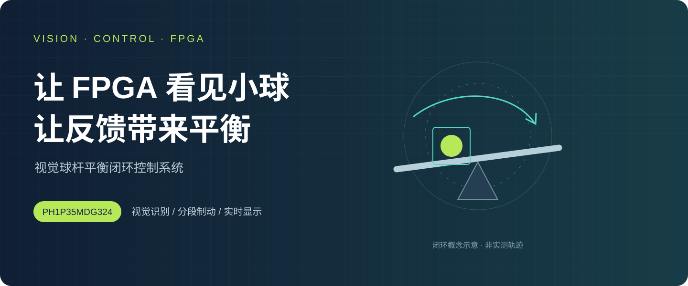
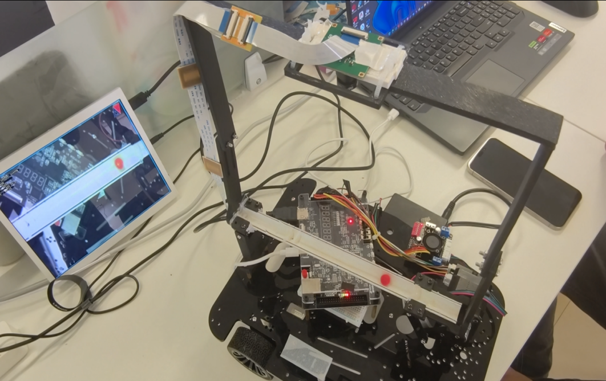
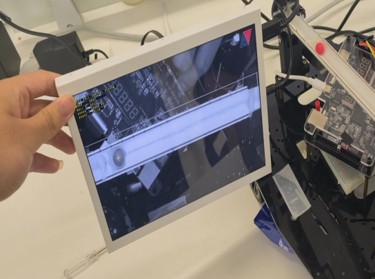
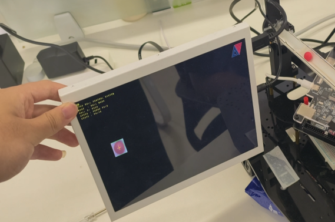
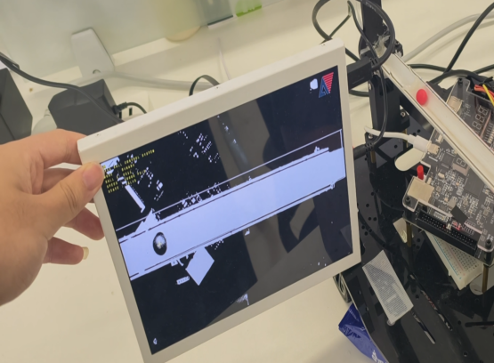
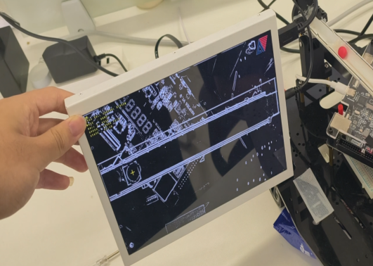
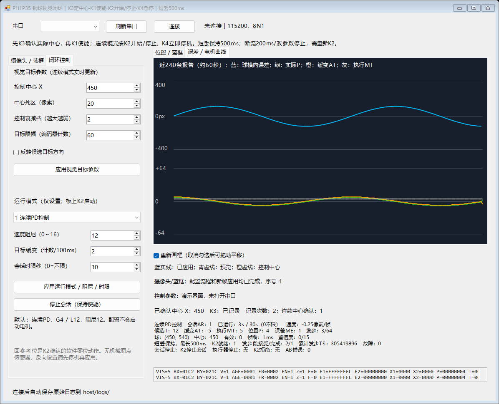

<p align="center"></p>

<h1 align="center">FPGA 视觉球杆平衡闭环控制</h1>
<p align="center">摄像头看位置，FPGA 做判断，电机调姿态，屏幕看状态。</p>
<p align="center"><b>安路 PH1P35</b> · <b>单轴视觉闭环</b> · <b>HDMI 多模式显示</b> · <b>上位机在线调试</b></p>
<p align="center"><a href="#我们做了什么">作品功能</a> · <a href="#作品实景与界面">实景与界面</a> · <a href="#如何演示">演示流程</a> · <a href="docs/GETTING_STARTED.md">工程入口</a> · <a href="docs/VALIDATION.md">验证记录</a></p>

## 作品简介

我们围绕球杆平衡任务，构建了集**视觉感知、闭环控制、实时显示与在线调试**于一体的 FPGA 系统。摄像头捕捉小球位置，FPGA 结合运动趋势与编码器反馈驱动机构调整姿态；HDMI 和上位机同步呈现图像、坐标与控制状态，让感知、决策、执行和观察形成完整链路。

**看见小球 → 判断运动趋势 → 调整球杆 → 反馈修正**，在单轴球杆平台上完成视觉与运动控制的协同设计。

## 我们做了什么

| 能力 | 在作品中能看到什么 |
|---|---|
| **看见小球** | 摄像头图像中的颜色目标检测、球心与外框输出，支持设置识别区域。 |
| **让反馈参与控制** | 球位置和电机编码器共同参与闭环；结合运动趋势进行分区调节与提前制动。 |
| **把过程展示出来** | HDMI 显示图像、检测标记和状态；包含原图、灰度、二值、边缘等六种显示模式。 |
| **让调试更直观** | 上位机设置曝光、增益、ROI 与控制参数，查看遥测和日志。 |
| **考虑异常与停止** | 实现启停、限位、视觉失效处理及执行预算等保护逻辑。 |

### 三个作品特点

- **视觉与执行在同一 FPGA 中协同**：图像处理、显示与控制分工运行，PC 负责配置和观察。
- **不只看“离中心多远”**：结合位置与运动趋势，采用分区控制、提前制动和静止保持策略。
- **控制过程可以被看见**：从检测画面到遥测面板，便于展示问题、调试过程和系统状态。

## 作品实景与界面



*作品平台：摄像头、FPGA 开发板、球杆执行机构与显示终端。*

| 图像显示 | 视觉检测 |
|:---:|:---:|
|  |  |
| 摄像头画面与现场显示 | 目标掩码与位置标记 |
|  |  |
| 二值化显示 | 边缘显示 |



*可视化上位机：在线配置参数，观察遥测曲线，记录调试过程。*

## 如何演示

1. **先看画面**：打开相机与 HDMI 显示，确认识别区域和小球标记。
2. **再设中心**：K1 使能，在满足有效识别等条件时通过 K3 记录参考中心。
3. **启动控制**：K2 启动或停止，观察小球位置、球杆动作和遥测变化。
4. **展示反馈与保护**：在受控条件下检查重新识别和停止行为；K4 停止并释放控制使能，同时会切换显示模式。

## 工程成果

| 成果 | 内容 |
|---|---|
| 系统集成 | 将视觉识别、单轴闭环、多模式显示与上位机调试整合为完整 FPGA 工程。 |
| 工程验证 | 23 项电机回归测试通过，完成 TD 布局布线与时序检查。 |
| 工程交付 | 提供 RTL、IP、引脚与时序约束、仿真源码、上位机及配套 bit，便于继续开发与展示。 |

## 从哪里开始看？

| 你想了解 | 入口 |
|---|---|
| 用网页浏览作品 | [展示页](site/index.html)：下载仓库后直接打开，无需安装依赖。 |
| 打开 FPGA 工程 | [工程使用说明](docs/GETTING_STARTED.md) · [TD 工程](project/td_project/vision_follow_20261022.al) |
| 查看硬件接线 | [接线说明](docs/WIRING.md) |
| 查看完整源码 | [project/](project/)：RTL、IP、约束、仿真和上位机。 |
| 核实版本和结果 | [验证记录](docs/VALIDATION.md) · [原始核验清单](project/motor_precise6_verification.json) |

<details>
<summary>工程目录</summary>

```text
assets/      作品图片与原创示意封面
site/        可离线打开的作品展示网页
docs/        工程入口、接线、验证与素材说明
project/     Logo + brake_precise6 + UART 修复工程
```

</details>

